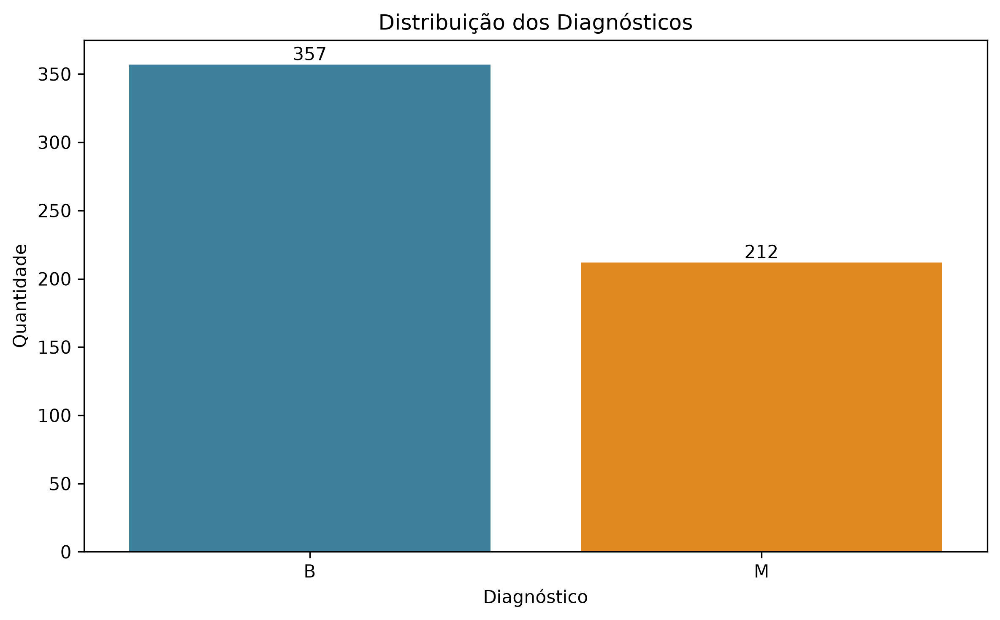
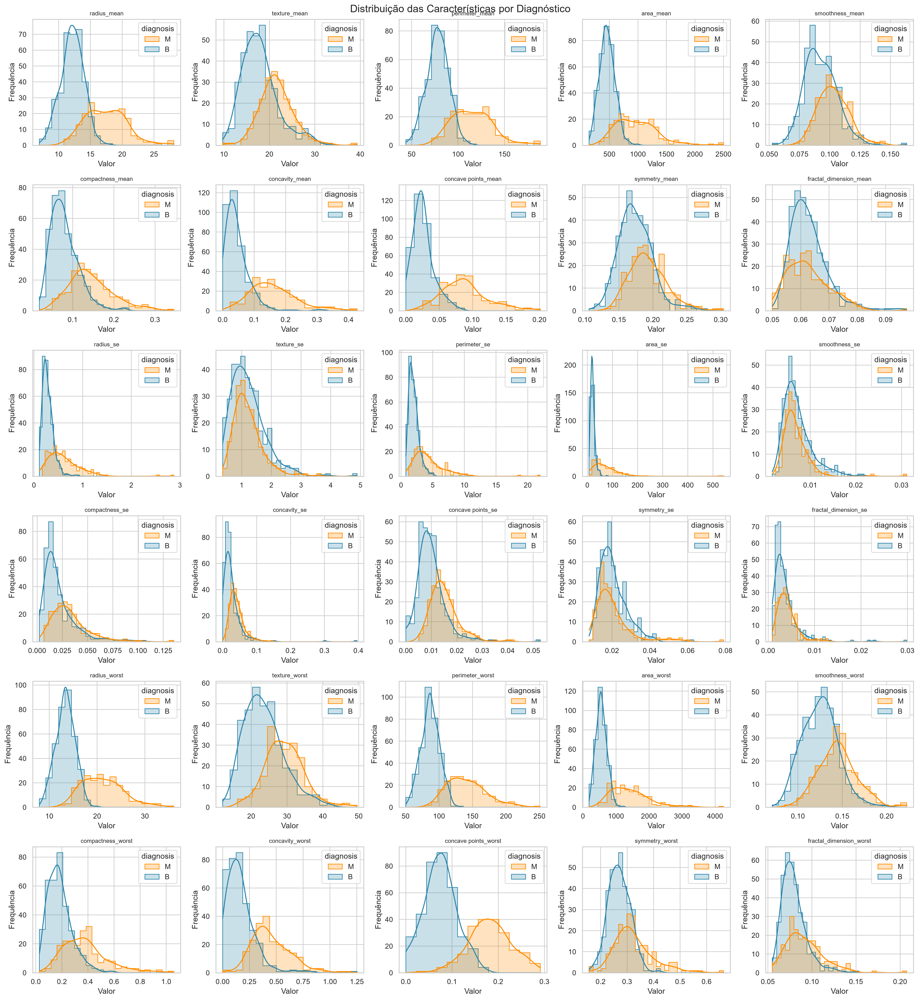
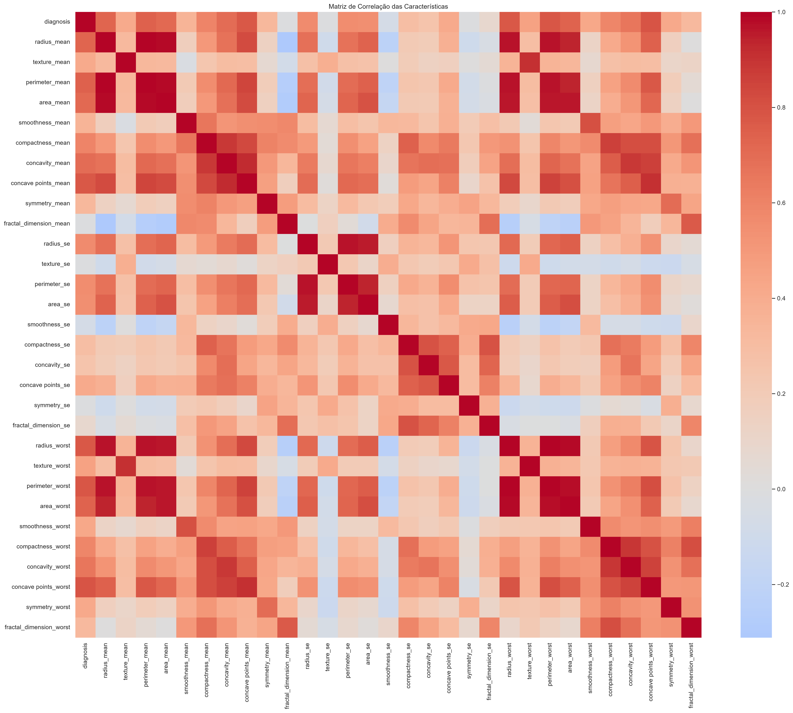
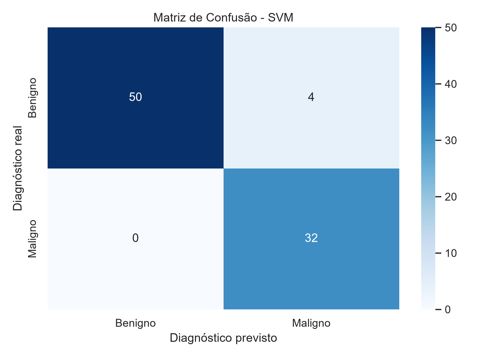
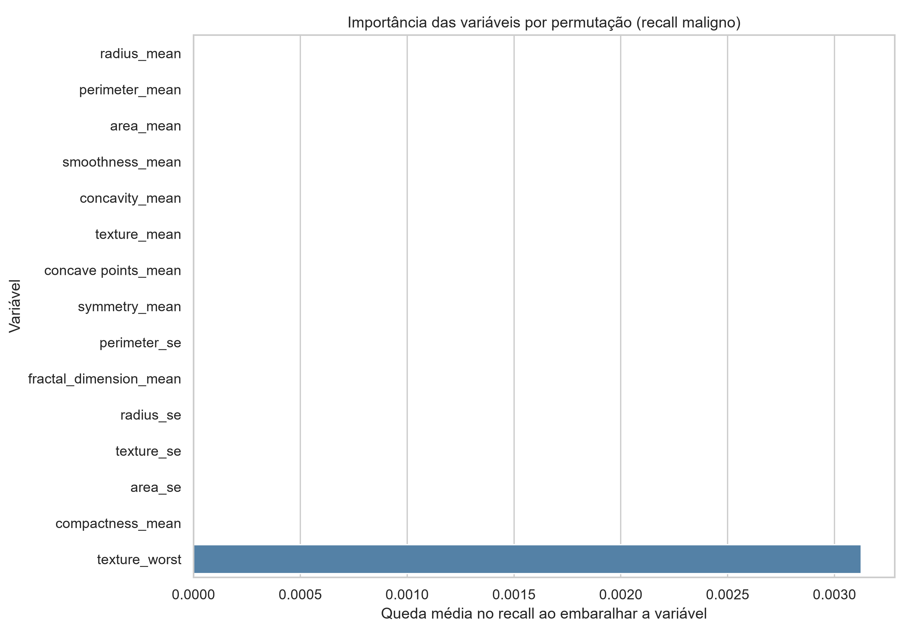
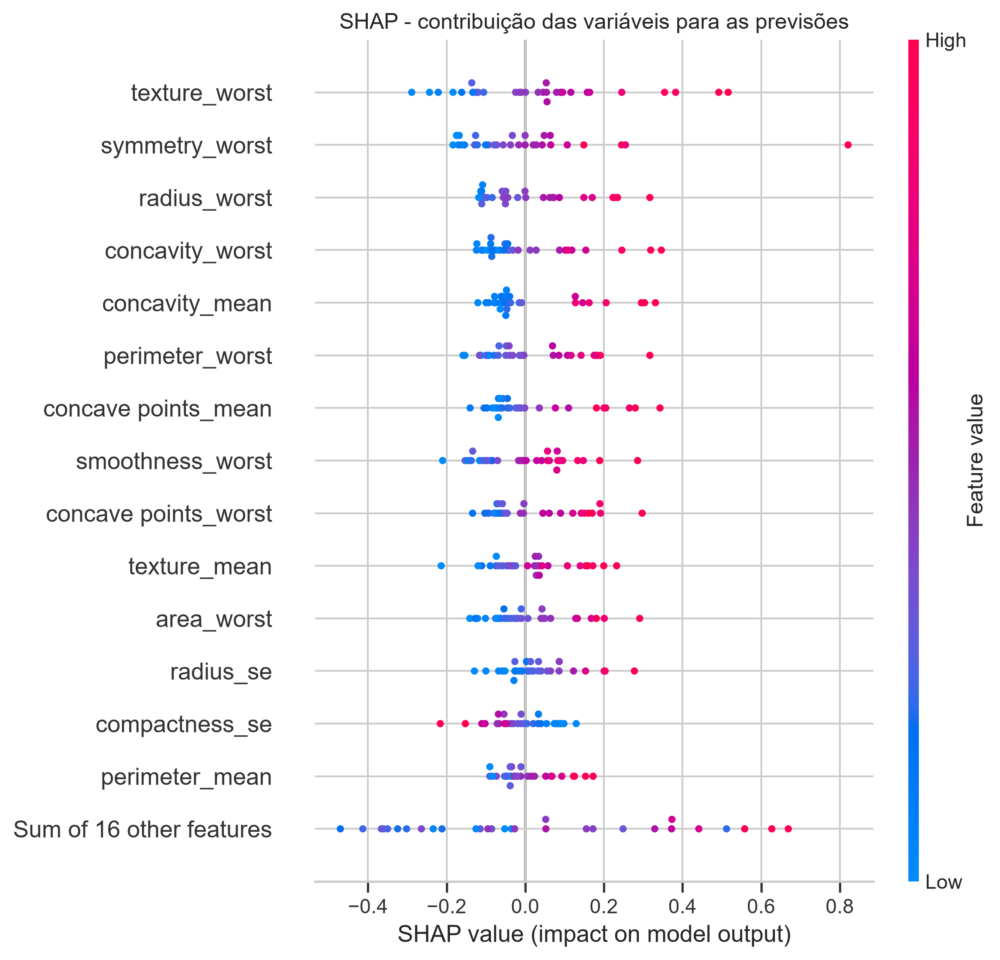
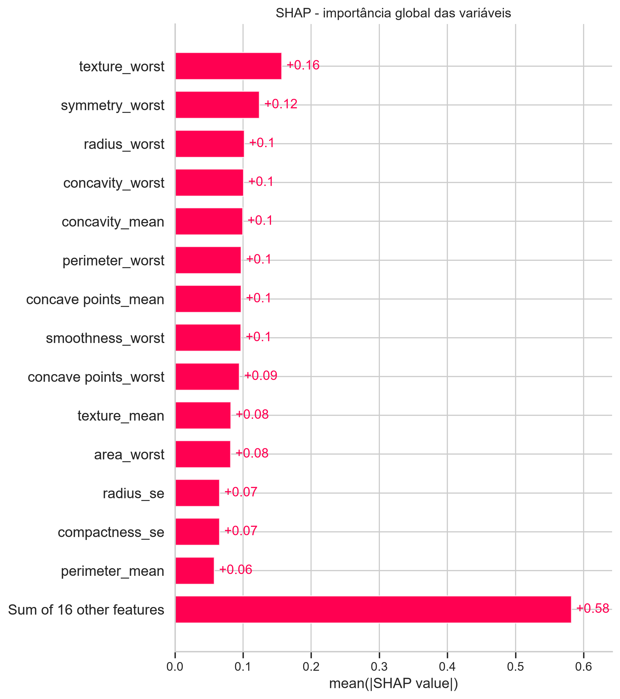

# TECH CHALLENGE 1 - IA PARA DEV´s

### **Turma:** 13IADT

## Participantes:

| Participante | RM |
|---|---|
| Douglas Wilson da Luz Dorigon | - |
| Edigar Pierott Torres | - |
| Eduardo Alves de Oliveira | RM374195 |
| José Henrique Siqueira Brandão | RM379302 |
| Ricardo dos Reis Xavier Santana | RM379133 |

# Classificação de câncer de mama

Projeto acadêmico de classificação binária com a base de câncer de mama do Tech Challenge. O programa compara Regressão Logística, SVM e Árvore de Decisão. A CNN será desenvolvida separadamente em um notebook e não faz parte da execução deste projeto.

## Tema e dados

O objetivo é classificar os registros como benignos ou malignos. A coluna `diagnosis` é o alvo: `B` significa benigno e `M`, maligno. A base usada pelo programa está em `data/breast_cancer.csv`.

## Exploração e pré-processamento

- O programa apresenta dimensões, tipos de dados, estatísticas descritivas e distribuição dos diagnósticos.
- A base contém uma coluna final vazia, que é removida por estar totalmente preenchida por valores ausentes.
- São verificadas a existência de valores ausentes, linhas duplicadas e IDs duplicados. Na cópia atual da base não há valores ausentes após a remoção da coluna vazia, nem linhas ou IDs duplicados.
- O `id` identifica o registro, mas não é usado como característica para previsão.
- Os diagnósticos são convertidos para números: benigno é `0` e maligno é `1`. Se houver valores ausentes nas características, os pipelines dos modelos os substituem pela mediana.
- A matriz de correlação e os gráficos exploratórios são gerados para apoiar a análise dos dados.

## Modelagem

Os registros são separados de forma estratificada em aproximadamente **70% para treino, 15% para validação e 15% para teste**. A estratificação mantém proporções semelhantes de casos benignos e malignos em cada parte.

São comparados três modelos:

- **Regressão Logística:** referência para classificação binária. Seu pipeline imputa valores ausentes e padroniza as características.
- **SVM:** usa kernel RBF para identificar padrões que não precisam ser separáveis por uma linha reta. Seu pipeline também imputa e padroniza as características, pois o SVM é sensível às escalas.
- **Árvore de Decisão:** cria regras a partir dos valores das características. Não precisa de padronização, mas uma árvore muito profunda pode memorizar os dados de treino.

## Treinamento e avaliação

O conjunto de teste (15%) fica separado durante a seleção do modelo. Os outros 85% (treino + validação) são usados em uma **validação cruzada estratificada de 5 partes**. Em cada rodada, quatro partes treinam o modelo e a parte restante avalia seu desempenho.

A comparação registra médias e variações de acurácia, precisão, recall e F1-score com o limiar padrão. Também reúne as previsões *out-of-fold* — previsões feitas por modelos que não treinaram com aqueles registros — e ajusta um limiar de classificação. A seleção prioriza o **F2-score**, que dá mais peso ao recall da classe maligna, e usa as outras métricas como critérios de desempate.

Depois da seleção, o modelo escolhido é treinado com os 85% de desenvolvimento. O limiar ajustado na validação cruzada é aplicado à avaliação final no conjunto de teste, que não é usado para escolher o modelo ou o limiar.

Como o limiar e as métricas *out-of-fold* são calculados a partir das mesmas previsões, esses resultados podem ser otimistas. O teste separado oferece uma avaliação final mais independente; ainda assim, representa apenas esta base de dados.

As métricas têm estes significados:

- **Accuracy (acurácia):** proporção total de previsões corretas.
- **Precision (precisão):** entre os casos previstos como malignos, quantos realmente são malignos.
- **Recall:** entre os casos realmente malignos, quantos o modelo identificou.
- **F1-score:** combina precision e recall.
- **F2-score:** também combina precision e recall, mas dá mais peso ao recall.

Priorizar o recall maligno busca reduzir falsos negativos, mas pode aumentar falsos positivos. Não garante que o modelo não vá deixar passar casos malignos.

### Interpretação

O projeto gera uma matriz de confusão, importância por permutação e gráficos SHAP. A importância por permutação verifica quanto uma característica contribui para o recall quando seus valores são embaralhados. O SHAP mostra como as características influenciam os scores do modelo. Eles medem aspectos diferentes e podem produzir rankings distintos; não demonstram causalidade ou importância clínica.

## Resultados desta execução

Na execução avaliada, a validação cruzada selecionou o SVM. No teste separado, com 86 registros, a matriz de confusão mostrou:

| Diagnóstico real | Previsto benigno | Previsto maligno |
|---|---:|---:|
| Benigno | 50 | 4 |
| Maligno | 0 | 32 |

O resultado foi accuracy de **95,3%**, precision maligna de **88,9%**, recall maligno de **100%** e F1-score de **94,1%**. Ou seja, nesse teste, 4 casos benignos foram sinalizados como malignos e nenhum caso maligno foi classificado como benigno. O resultado é específico a esta divisão e não garante o mesmo desempenho em novos dados.

## Fazer uma previsão com valores informados

Ao executar `python main.py`, o modelo selecionado é exportado pela etapa `ExportBreastCancer` para `results/breast_cancer_model.joblib`. Depois, rode:

```powershell
python predict.py
```

O programa solicitará, uma por vez, as 30 características esperadas pelo modelo e exibirá a classificação **Benigno** ou **Maligno**. São aceitos ponto ou vírgula como separador decimal. Os valores precisam corresponder às mesmas características e unidades da base `data/breast_cancer.csv`; o programa rejeita entradas que não sejam numéricas ou estejam ausentes.

Para usar o fluxo interativo com Docker após montar `results` como indicado abaixo:

```powershell
docker run --rm -it --mount "type=bind,source=$resultsPath,target=/app/results" cancer-mama python predict.py
```

Para utilizar a previsão em outro código Python, importe `BreastCancerPredictor` de `src.cancer_de_mama.prediction.breast_cancer_predictor` e chame `predict_one()` com um dicionário contendo os nomes e valores das 30 características.

O SVM usa a estimativa de probabilidade do scikit-learn para apresentar probabilidades aproximadas de cada classe. Essas porcentagens não são medidas de precisão ou certeza clínica. Esta previsão é uma demonstração acadêmica; não deve ser usada para diagnosticar ou orientar tratamento.

## Interface web para previsão de CSV

Depois de gerar o modelo com `python main.py`, inicie a API e a página web:

```powershell
python web.py
```

Abra `http://127.0.0.1:8000` no navegador. A página permite enviar um CSV, visualizar a classificação estimada de cada linha, ordenar benignos ou malignos primeiro ou priorizar registros mais próximos do limite de decisão, e baixar um CSV de exemplo. A planilha deve ter as 30 colunas numéricas com os mesmos nomes usados na base; `id` e `diagnosis` são opcionais e ignorados. São aceitos arquivos de até 5 MB e 2.000 registros. A ordenação por proximidade não representa probabilidade: para o SVM, o score é uma medida de decisão, não um percentual de certeza.

A API também disponibiliza a documentação interativa em `http://127.0.0.1:8000/docs`. O endpoint `POST /api/predict` recebe o arquivo no campo `file`; `GET /api/health` informa se o artefato do modelo está disponível. A interface mostra a probabilidade estimada para as classes benigna e maligna. A ordenação por proximidade de 50% usa a probabilidade estimada de malignidade; esses valores não são medidas de precisão ou certeza clínica. Após atualizar o código, execute `python main.py` novamente para exportar um modelo com estimativas de probabilidade antes de iniciar a API.

Para executar a interface com Docker, primeiro monte o modelo no diretório local `results`, depois inicie o servidor:

```powershell
$resultsPath = (Resolve-Path .).Path + "\results"
$resultsPath = (Resolve-Path .).Path + "\results"
New-Item -ItemType Directory -Force -Path $resultsPath | Out-Null
docker run --rm --mount "type=bind,source=$resultsPath,target=/app/results" cancer-mama
docker run --rm -p 8000:8000 --mount "type=bind,source=$resultsPath,target=/app/results" cancer-mama python web.py --host 0.0.0.0
```

Abra `http://127.0.0.1:8000` no navegador. A aplicação é apenas uma demonstração acadêmica e não deve ser usada para decisões médicas.

### Gráficos desta execução

Os gráficos abaixo ilustram a distribuição dos diagnósticos, os erros e acertos do modelo e as análises de importância e SHAP. São resultados deste experimento acadêmico, não evidência de desempenho clínico.

**Distribuição dos diagnósticos**



**Distribuição das características**



**Correlação entre as características**



**Matriz de confusão no conjunto de teste**



**Importância por permutação para o recall maligno**



**SHAP — contribuição das características nas previsões**



**SHAP — importância global**



## Execução local

Requisitos: Python 3.12 e `pip`.

No PowerShell, a partir da pasta do projeto:

```powershell
py -3.12 -m venv .venv
.\.venv\Scripts\Activate.ps1

python -m pip install --upgrade pip


pip install -r requirements.txt


python main.py

```

Se a ativação do ambiente virtual estiver bloqueada no PowerShell, use o interpretador diretamente:

```powershell
.\.venv\Scripts\python.exe -m pip install -r requirements.txt
.\.venv\Scripts\python.exe main.py
```

## Execução com Docker

Com Docker Desktop instalado e iniciado, execute na raiz do projeto:

```powershell
docker build -t cancer-mama .
$resultsPath = (Resolve-Path .).Path + "\results"
New-Item -ItemType Directory -Force -Path $resultsPath | Out-Null
docker run --rm --mount "type=bind,source=$resultsPath,target=/app/results" cancer-mama
```

O volume mantém os resultados no diretório `results` do computador após o contêiner terminar.

## Arquivos gerados

Os resultados ficam em `results/`:

- `estatisticas_descritivas.csv`: estatísticas das características.
- `matriz_correlacao.csv` e `graphics/matriz_correlacao.png`: correlações entre as colunas.
- `metrics/comparacao_modelos_validacao_cruzada.csv`: comparação dos modelos nos cinco folds e métricas *out-of-fold*.
- `metrics/metricas_teste.csv`: métricas finais no teste separado.
- `breast_cancer_model.joblib`: modelo selecionado e limiar usado pelo programa `predict.py`.
- `metrics/importancia_caracteristicas.csv` e `graphics/importancia_caracteristicas.png`: importância por permutação.
- `graphics/matriz_confusao_teste.png`, `graphics/shap_beeswarm.png` e `graphics/shap_importance.png`: visualizações da avaliação e explicabilidade.

## Limitações e uso responsável

- Este é um projeto acadêmico usando uma única base pública e uma quantidade limitada de registros. 
- Validação cruzada e teste ajudam a avaliar o comportamento do modelo nesta base, mas não comprovam segurança ou eficácia em pacientes reais. 
- O modelo não é uma ferramenta médica validada, não substitui exames ou avaliação profissional e não deve determinar diagnósticos ou tratamentos. 

## **A decisão clínica cabe ao profissional de saúde.**
